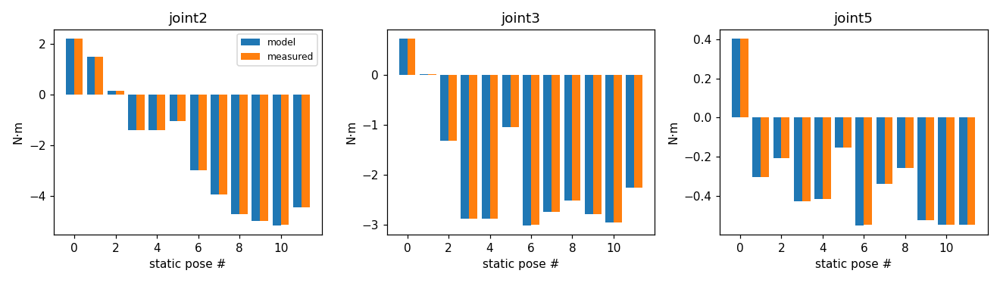
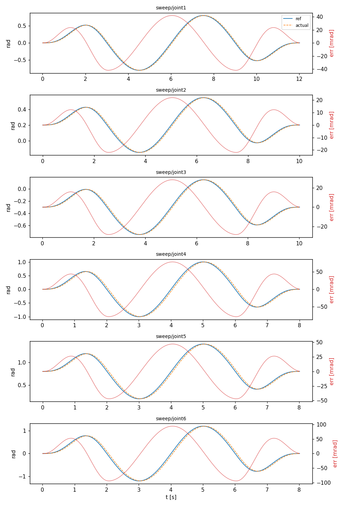

# 04. 시뮬레이션 기준선 (로드맵 0단계)

모터를 사기 전에, **나중에 실물과 비교할 기준 기록**을 시뮬레이션으로 만든다.
이 단계가 끝나면 실물 단계마다 "같은 동작을 실물에 돌리고, 같은 분석 스크립트로 시뮬레이션과 비교"만 하면 된다.

## 0. 전체 구조

```
run_reference.py  ──(FollowJointTrajectory 액션)──▶  arm_controller (joint1~6)
  기준 궤적 재생                                       gripper_controller (핑거 2개)
  + rosbag 기록                                              │ 위치 명령, 200 Hz
                                                             ▼
                                   ros2_control 하드웨어:  mock  |  Gazebo  |  (나중에) Damiao 실물
                                                             │ 위치·속도·토크 상태
                                                             ▼
                                   joint_state_broadcaster ──▶ /joint_states ──▶ rosbag ──▶ analyze_baseline.py
```

| 하드웨어 | 무엇을 확인하나 | 토크(effort) |
|---|---|---|
| mock | 컨트롤러 설정, 궤적 전송, 기록·분석 파이프라인 | 없음 (0) |
| Gazebo | 중력·관성이 들어간 동작, 관절 토크 | 있음 |
| 실물 (5단계~) | 같은 궤적, 같은 분석 | 모터가 보고하는 토크 |

컨트롤러·궤적·분석은 셋이 **공통**이고 하드웨어만 바뀐다.

### 이 단계에서 추가된 파일

```
arm_description/urdf/arm.ros2_control.xacro     ros2_control 하드웨어 정의 (mock / Gazebo)
arm_description/urdf/arm.urdf.xacro             sim_mode 인자 추가 (none | mock | gazebo)
arm_bringup/
  config/controllers.yaml                       컨트롤러 설정 (전체 팔)
  config/controllers_j1to3.yaml                 컨트롤러 설정 (J1~J3 단계용)
  config/controllers_gazebo_overrides.yaml      Gazebo에서만 덮어쓰는 설정 (그리퍼)
  config/reference_trajectories.yaml            기준 궤적 세트 (고정)
  launch/mock.launch.py                         mock 하드웨어 실행
  launch/gazebo.launch.py                       Gazebo 실행
  scripts/run_reference.py                      기준 궤적 재생 + 기록
  scripts/analyze_baseline.py                   기록 분석 (CSV, 요약, 그래프)
```

---

## 1. 준비

[03. 개발 환경](03_dev_setup.md)을 마치고 빌드한다.

```bash
cd ~/arm_ws && colcon build --symlink-install && source install/setup.bash
mkdir -p ~/arm_logs        # 기록을 모아 둘 폴더
```

## 2. mock 하드웨어로 실행

**터미널 1**

```bash
ros2 launch arm_bringup mock.launch.py
```

RViz가 뜨고 팔이 홈 자세로 보인다 (슬라이더 창은 뜨지 않는다. 이제 관절은 컨트롤러가 움직인다).

**터미널 2** — 확인

```bash
ros2 control list_controllers
```

세 컨트롤러가 모두 `active`여야 한다.

```
joint_state_broadcaster  joint_state_broadcaster/JointStateBroadcaster          active
arm_controller           joint_trajectory_controller/JointTrajectoryController  active
gripper_controller       joint_trajectory_controller/JointTrajectoryController  active
```

```bash
ros2 topic hz /joint_states       # average rate: 약 200
```

## 3. 기준 궤적 세트

`arm_bringup/config/reference_trajectories.yaml` (version 2). **이 파일은 고정한다.** 바꾸면 이전 기록과 비교할 수 없으므로, 바꿀 때는 `version`을 올리고 기록을 새로 만든다.

| 세트 | 내용 | 목적 |
|---|---|---|
| `home` | 홈 자세로 이동 | 시작·끝 정렬 |
| `sweeps` | ready 자세에서 한 관절씩 사인파로 흔들기 (6개). 최고 속도는 각 모터 정격 속도의 25% 이하 | 관절별 추종 특성 (지연, 마찰) |
| `static` | 정지 자세 12개에서 3초씩 멈추기 | 중력 토크 → 질량·무게중심 식별 |
| `pick` | A 지점에서 집어 B 지점에 놓기 (그리퍼 아래 방향) | 실제 작업에 가까운 동작 |

- 모든 자세와, 자세 사이를 직선으로 잇는 경로는 미리 검사했다: 관절 한계(여유 0.05 rad), 자기간섭, 바닥 높이 3 cm 이상
- 픽앤플레이스 관절값은 TCP 목표(예: A 위 (0.30, 0.12, 0.15) m)에 대해 역기구학으로 계산했다 (위치 오차 < 0.1 mm, 그리퍼 기울기 < 0.5°)
- 자세 사이 이동은 5차 다항식(정지 → 정지), 이동 시간 3초
- 한 번 실행 시간: 약 3분 30초 (시뮬레이션 시간 기준)

## 4. mock 기록과 분석

**터미널 2** (터미널 1의 mock은 켜 둔 채)

```bash
ros2 run arm_bringup run_reference.py --set all --bag ~/arm_logs/mock_baseline
```

- 로그에 `[start] sweep/joint1` … `[end  ] run` 이 차례로 나오고, 마지막에 `기록 완료: ...` 가 나오면 성공
- `--bag` 폴더가 이미 있으면 기록이 실패한다. 다른 이름을 쓰거나 지우고 다시 한다
- 일부만 돌리기: `--set sweeps --only joint2,joint3`, `--set static`

```bash
ros2 run arm_bringup analyze_baseline.py ~/arm_logs/mock_baseline
```

`~/arm_logs/mock_baseline/analysis/`에 생기는 파일:

| 파일 | 내용 |
|---|---|
| `summary.md` | 구간별 추종 오차 표, 정지 자세 토크 표 |
| `joint_states.csv` | 시간, 관절별 위치·속도·토크 |
| `tracking.csv` | 시간, 관절별 목표·실제·오차 |
| `sweeps.png`, `static_torque.png` | 그래프 |

mock에서 기대되는 결과 ([결과 예시](results/00_sim_baseline/mock_summary.md)):
- 추종 오차는 수 mrad 이하 (컨트롤러 보간 오차뿐)
- 정지 자세 토크는 `측정 토크가 모두 0 → ... 토크 비교는 생략` (mock은 토크를 계산하지 않음)
- 모델 유지 토크 열은 채워진다. 예: 홈 자세(static/06)에서 J2·J3 약 −3.02 N·m

## 5. Gazebo로 실행

터미널 1의 mock을 `Ctrl+C`로 끄고:

```bash
ros2 launch arm_bringup gazebo.launch.py                # Gazebo 창 + RViz
ros2 launch arm_bringup gazebo.launch.py gui:=false     # 창 없이 (더 빠름)
```

Gazebo 창에 팔이 홈 자세로 서 있고, 중력에도 처지지 않으면 정상이다. 2절의 확인 명령을 그대로 써서 컨트롤러 3개가 `active`인지 본다.

홈 자세 토크를 바로 확인할 수 있다.

```bash
ros2 topic echo --once /joint_states
```

`effort`에서 joint2·joint3가 약 −3.02, joint4 약 −0.14, joint5 약 −0.55 이면 URDF 질량대로 중력이 걸리고 있는 것이다.

### Gazebo에서만 다른 점 두 가지

1. **위치 루프가 느리다.** Gazebo 연동 플러그인(gz_ros2_control 0.7.x)은 위치 명령을 `속도 = 게인 × 오차 × 200 Hz` 로 바꾼다. 게인이 기본값 0.1로 고정되어(이 버전은 설정 파일로 바꿀 수 없음) `속도 = 20 × 오차`, 즉 **시정수 약 50 ms의 1차 지연**처럼 움직인다. 그래서 Gazebo의 추종 오차는 실물 모터보다 크게 나온다. 시뮬레이터 특성으로 기록만 한다
2. **그리퍼 핑거는 힘(effort)으로 구동한다.** 이 Gazebo 조합에서 오른쪽 핑거 관절이 속도 명령에 움직이지 않는 현상이 있었다. 같은 관절이 힘 명령에는 정상 동작해서, Gazebo에서만 그리퍼 컨트롤러가 PD 제어로 힘을 내도록 했다 (`controllers_gazebo_overrides.yaml`). mock·실물은 위치 명령 그대로다. 원인은 아직 확인하지 못했다 (Gazebo 단독 월드에서는 같은 관절이 속도 명령으로 움직임)

## 6. Gazebo 기록과 분석

Gazebo는 시뮬레이션 시간(`/clock`)을 쓰므로 **`--sim-time`을 꼭 붙인다.** 빠뜨리면 구간 표시 시간과 기록 시간이 어긋나 분석이 비게 된다.

```bash
ros2 run arm_bringup run_reference.py --set all --sim-time --bag ~/arm_logs/gazebo_baseline
ros2 run arm_bringup analyze_baseline.py ~/arm_logs/gazebo_baseline --compare ~/arm_logs/mock_baseline
```

PC가 느리면 Gazebo가 실시간보다 느리게 돌아 실제 시간이 더 걸린다 (시뮬레이션 시간은 같음). `gui:=false`로 줄일 수 있다.

## 7. 결과와 해석

결과 요약: [Gazebo](results/00_sim_baseline/gazebo_summary.md), [mock](results/00_sim_baseline/mock_summary.md) (Ubuntu 22.04 + apt 설치 ROS 2 Humble 실기 PC에서 측정)

- 2026-11-11 재기록: 키트 모터 구성(J1~J3 4340P, J4~J6 4310, 그리퍼 H3510), 손목 L5 95 mm, 그리퍼 랙 안내 구조, 기준 궤적 **version 2**
- 이전 기록(2026-11-04, 이전 모터 구성·version 1)은 이 기록으로 교체했다. 이후 단계는 이 기록과 비교한다
- 액추에이터 질량·형상을 바꾸면(예: 모터 실측 질량 반영) 모델 유지 토크가 달라지므로 기준선을 다시 기록한다

### 7-1. 정지 자세 토크: 측정 vs 모델



12개 자세 × 3관절에서 **측정 − 모델: 평균 +0.002, RMS 0.002, 최대 0.005 N·m**. 홈 자세(static/06) J2·J3 −3.005 / 모델 −3.008 N·m.

- 의미: 기록 → 분석 → 중력 모델 계산까지의 사슬이 맞게 동작한다는 확인이다
- Gazebo와 모델이 **같은 URDF**를 쓰므로 이 일치가 "URDF 질량이 실물과 맞다"는 뜻은 아니다. 실물과의 비교는 J1~J3 단계(로드맵 3단계)에서 같은 표로 한다. 그때 차이가 곧 질량·무게중심 보정량이 된다

### 7-2. 스윕 추종 오차



| 관절 | 스윕 최고 속도 [rad/s] | 1차 지연 예상 최대 오차 = 속도 ÷ 20 [mrad] | 측정 최대 오차 [mrad] |
|---|---|---|---|
| joint1 | 0.84 | 42 | 41.8 |
| joint2 | 0.44 | 22 | 22.0 |
| joint3 | 0.57 | 28 | 28.2 |
| joint4 | 1.57 | 79 | 78.3 |
| joint5 | 0.94 | 47 | 47.0 |
| joint6 | 1.88 | 94 | 94.0 |

측정값이 5절의 1차 지연 모델과 정확히 맞는다. mock의 최대 오차(예: joint1 4.6 mrad)는 200 Hz 한 주기 동안 움직이는 양(0.84 rad/s × 5 ms ≈ 4.2 mrad) 정도의 보간 오차다. 즉 Gazebo의 추종 오차는 시뮬레이터 위치 루프 때문이고, 다른 문제(관절 걸림, 컨트롤러 설정 오류)는 없다는 뜻이다.
실물 단계에서는 같은 표에 실물 측정값이 들어가고, 그 차이로 모터 위치 루프를 모델링한다.

## 8. 기록 보관 규칙

- 폴더 이름: `~/arm_logs/<날짜>_<환경>_<설명>` 예: `2026-11-11_gazebo_baseline_v2`
- 기준선 bag은 지우지 않는다. 이후 모든 단계의 비교 대상이다
- `summary.md`와 그래프는 `docs/results/<단계>/`에 복사해 저장소에 남긴다 (bag 원본은 크므로 저장소에 넣지 않음)

## 9. 문제 해결

| 증상 | 원인과 해결 |
|---|---|
| `package '<다른 패키지>' not found, searching: [...]` 로 launch가 바로 종료 | Gazebo launch(`ros_gz_sim`)가 설치된 **모든** 패키지를 훑어 모델·플러그인 경로를 모으는데, 다른 워크스페이스의 깨진 패키지에서 멈춘 것. 주로 `--symlink-install`로 빌드한 뒤 그 워크스페이스의 `build/`나 소스를 지운 경우 (설치 폴더에 끊어진 링크가 남음). 해결: ① 그 워크스페이스를 다시 빌드하거나 ② `~/.bashrc`에서 그 워크스페이스의 `source` 줄을 지운다. 그래도 재발하면 이미 설정된 환경 변수가 남아 있는 것이므로 아래 [환경 변수 초기화](#환경-변수-초기화)를 한다. 지금 쓰는 워크스페이스만 source 하는 것이 안전 |
| 스포너가 `Could not contact service /controller_manager/list_controllers` 로 종료 | Gazebo에서 ros2_control 플러그인이 안 뜬 것. Gazebo 로그에서 `Failed to load system plugin [gz_ros2_control-system]` 확인 → `ros-humble-gz-ros2-control` 설치 확인. launch가 플러그인 경로(`IGN_GAZEBO_SYSTEM_PLUGIN_PATH`)를 자동으로 추가함 |
| Gazebo에 팔이 안 보이거나 메쉬 오류 | launch가 `IGN_GAZEBO_RESOURCE_PATH`에 share 폴더를 넣는다. `source install/setup.bash`를 했는지 확인 |
| `궤적 실패: ... path tolerance violation` | 목표와 실제 차이가 허용치(팔 0.3 rad, 그리퍼 10 mm)를 넘음. Gazebo가 극도로 느리거나 관절이 걸린 경우. `ros2 topic echo /arm_controller/state`로 어느 관절인지 확인 |
| 분석 결과 표가 비어 있음 | Gazebo 기록에 `--sim-time`을 빠뜨림. 다시 기록 |
| `--bag` 기록 실패 | 같은 이름의 폴더가 이미 있음 |
| 그래프가 안 생김 | `sudo apt install python3-matplotlib` |

### 환경 변수 초기화

다른 워크스페이스의 경로가 환경 변수에 남아 있으면 `.bashrc`를 고쳐도 같은 에러가 반복된다. 현재 터미널에서 ROS 관련 경로를 모두 지우고 필요한 것만 다시 source 한다.

```bash
unset AMENT_PREFIX_PATH COLCON_PREFIX_PATH CMAKE_PREFIX_PATH PYTHONPATH LD_LIBRARY_PATH ROS_PACKAGE_PATH
source /opt/ros/humble/setup.bash
source ~/ros2_ws/install/setup.bash        # 지금 쓰는 워크스페이스
echo $AMENT_PREFIX_PATH | tr ':' '\n'      # 남은 경로 확인: /opt/ros/humble 과 지금 워크스페이스만 있어야 함
```

`LD_LIBRARY_PATH`, `PYTHONPATH`를 지우므로 ROS와 무관하게 직접 넣어 둔 값이 있었다면 그것도 다시 설정한다.

## 10. 체크리스트

완료: 2026-11-11 (현재 모델, 기준 궤적 version 2)

- [x] mock: 컨트롤러 3개 active, `/joint_states` 200 Hz
- [x] mock: `run_reference.py --set all` 완료, `analyze_baseline.py` 요약 생성
- [x] Gazebo: 홈 자세에서 처지지 않음, joint2 effort 약 −3.02 N·m
- [x] Gazebo: `--sim-time`으로 전체 세트 완료, 정지 자세 토크가 모델과 일치
- [x] 기준선 bag 두 개(`mock_baseline`, `gazebo_baseline`) 보관, 요약을 `docs/results/`에 복사

다음 단계: 모터 단품 벤치 (로드맵 1단계) — 4340P 1개, 4310 1개로 CAN 설정, 모터 특성 측정, 1축 하드웨어 인터페이스.

## 부록: 검증 환경

이 문서의 결과는 RoboStack(conda)으로 설치한 ROS 2 Humble + Gazebo Fortress(ign-gazebo 6), gz_ros2_control 0.7.19, ros2_control 2.54에서 얻었다.
apt로 설치한 Ubuntu 22.04에서도 같은 명령으로 돌아가도록 작성했다.

## 부록 A. ros2_control 구성

ros2_control은 **"무엇을 할지(컨트롤러)"와 "실제로 움직이는 장치(하드웨어)"를 분리**하는 틀이다. 둘 사이는 이름이 붙은 숫자 칸(인터페이스)으로만 주고받는다.

```
   ┌─ 컨트롤러 (controllers.yaml) ──────────────────────────┐
   │ arm_controller      : 궤적을 받아 매 주기 목표 위치 계산 │
   │ gripper_controller  : 그리퍼 궤적                        │
   │ joint_state_broadcaster : 상태를 /joint_states로 발행    │
   └──────────────┬───────────────────────▲─────────────────┘
       명령 인터페이스                     │ 상태 인터페이스
       joint2/position                     │ joint2/position, velocity, effort
                  ▼                        │
   ┌─ controller_manager (200 Hz 루프: read → update → write) ┐
   └──────────────┬───────────────────────▲─────────────────┘
                  ▼                        │
   ┌─ 하드웨어 (URDF의 <ros2_control> 태그) ─────────────────┐
   │ mock : 명령을 그대로 상태로 복사                        │
   │ Gazebo : 물리 엔진의 관절에 명령, 관절 상태를 읽음       │
   │ 실물 : CAN으로 모터에 명령, 모터 응답을 읽음 (1단계~)    │
   └──────────────────────────────────────────────────────┘
```

| 파일 | 정하는 것 |
|---|---|
| `arm_description/urdf/arm.ros2_control.xacro` | 하드웨어 종류(플러그인)와 관절별 명령·상태 인터페이스 |
| `arm_bringup/config/controllers.yaml` | 어떤 컨트롤러를 어떤 관절에, 몇 Hz로 |
| `arm_bringup/launch/*.launch.py` | controller_manager를 띄우고(mock은 `ros2_control_node`, Gazebo는 플러그인 안에서) 컨트롤러를 하나씩 켬(spawner) |

매 주기(5 ms)마다 일어나는 일:
1. **read**: 하드웨어에서 현재 위치·속도·토크를 읽어 상태 칸에 넣음
2. **update**: `arm_controller`가 "지금 시각에 있어야 할 위치"를 궤적에서 보간해 명령 칸에 넣음
3. **write**: 하드웨어가 명령 칸의 값을 실제 장치로 보냄

사용하는 쪽(`run_reference.py`, 나중에 MoveIt)은 `/arm_controller/follow_joint_trajectory` 액션으로 "몇 초에 어느 각도" 목록만 보낸다. 하드웨어가 mock이든 실물이든 보내는 쪽 코드는 같다. 실물 단계에서는 하드웨어 칸에 Damiao용 플러그인 하나만 추가하면 된다.

## 부록 B. 결과 계산 방법

### 추종 오차

`arm_controller`는 100 Hz로 `/arm_controller/state`를 발행한다. 여기에 **목표**(궤적에서 지금 있어야 할 위치)와 **실제**(하드웨어가 읽은 위치)가 같이 들어 있다.

- 오차 = 목표 − 실제 (샘플마다)
- 구간(`/reference_events`의 start~end) 안의 샘플로
  - RMS = √(오차² 평균) → 평균적인 크기
  - 최대 = |오차|의 최댓값 → 최악의 순간
- 단위 mrad (1 mrad = 0.057°)

왜 그 값이 나오나:
- **mock**: 명령이 다음 주기에 상태로 돌아오므로 실제가 한 주기(5 ms) 늦다 → 오차 ≈ 속도 × 0.005 s. 예: joint1 최고 0.84 rad/s → 4.2 mrad
- **Gazebo**: 플러그인이 `속도 명령 = 0.1 × 오차 × 200 = 20 × 오차`로 움직인다. 일정한 속도 v로 따라가려면 오차가 v/20만큼 있어야 한다 → 최대 오차 ≈ 최고 속도 ÷ 20. 예: joint1 0.84 ÷ 20 = 42 mrad

### 정지 자세 토크

- **측정**: 자세마다 3초 멈추는 동안 `/joint_states`의 effort를 기록하고, 흔들림이 가라앉은 **마지막 1.5초를 평균**
- **모델**: URDF에서 각 링크의 질량 m과 무게중심 위치를 읽어 계산
  1. 그 자세의 관절각으로 순기구학을 풀어 모든 링크 무게중심의 월드 좌표를 구함
  2. 관절 i보다 끝 쪽에 있는 링크마다 중력 모멘트 = (무게중심 − 관절 위치) × (m · g)
  3. 그 모멘트를 관절 축 방향 성분만 더함 → 중력이 관절을 돌리려는 토크
  4. 부호를 뒤집음 → 그 자세를 버티려고 모터가 내야 하는 토크

예: 홈 자세 joint3. J3보다 끝 쪽 질량 합 1.440 kg, 무게중심이 J3에서 수평으로 214.0 mm 앞.
1.440 kg × 9.81 m/s² × 0.2140 m = **3.023 N·m** → 표의 모델값 −3.019 (질량·거리 반올림 차이) (부호는 축 방향 기준)

- **측정 − 모델**: 12자세 × 3관절(J2, J3, J5) 차이의 평균·RMS·최대
  - Gazebo에서 거의 0인 것은 기록·분석 과정이 맞다는 뜻 (둘 다 같은 URDF)
  - 실물에서 차이가 나면 그만큼 실제 질량·무게중심이 URDF와 다르다는 뜻 → 3단계에서 이 차이로 URDF를 보정
