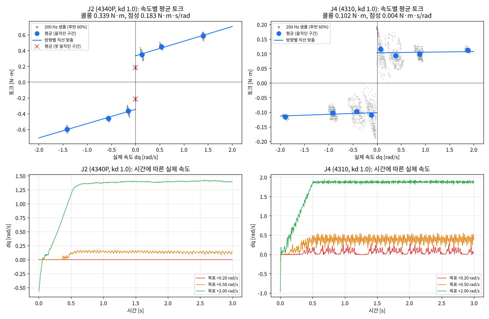
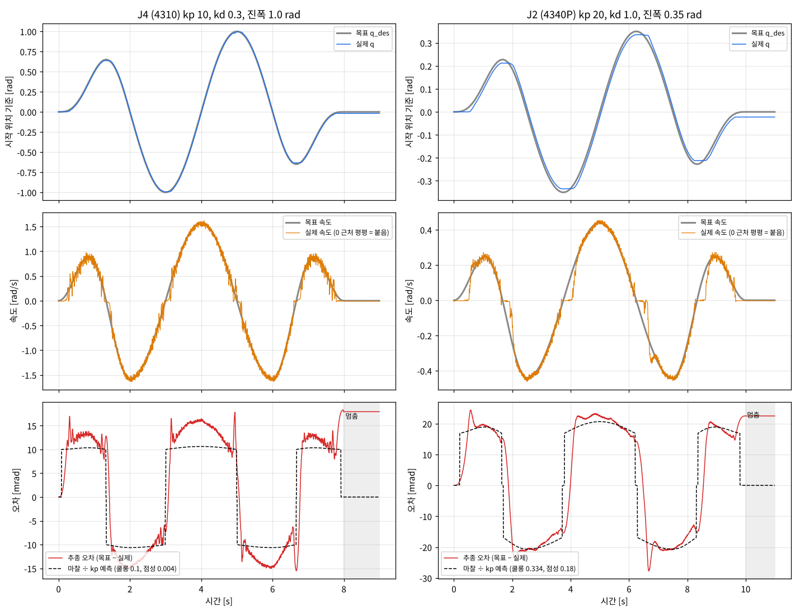
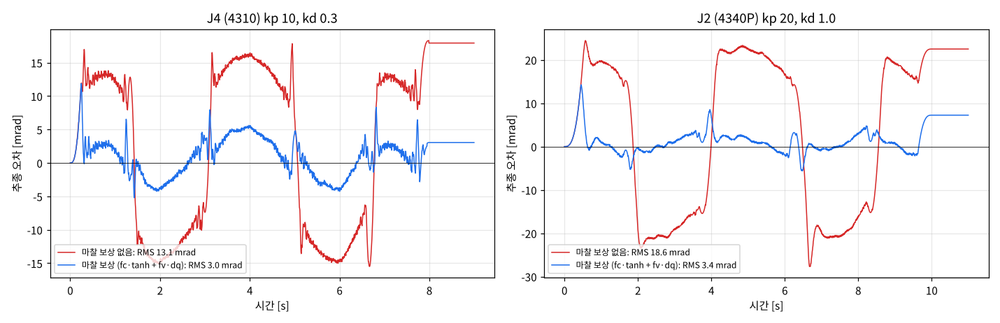

# 1단계 모터 벤치 결과

## 2026-11-23 첫 연결 (J2 = 4340P, J4 = 4310)

연결: 벤치 파워 24 V → Damiao 전원 보드 → XT30(2+2) → 모터, CAN은 Damiao USB2CAN(REV V3.0, 종단저항 스위치 ON = 120 Ω) → PC `/dev/ttyACM0` (`--iface damiao-serial`)

### 공장 출고 상태 (`dm_bench scan`, `info`)

| 항목 | 4340P | 4310 |
|---|---|---|
| ESC_ID / MST_ID | 0x01 / 0x00 | 0x01 / 0x00 |
| 제어 모드 | 1 (MIT) | 1 (MIT) |
| PMAX / VMAX / TMAX | 12.5 / **10** / 28 | 12.5 / 30 / 10 |
| 감속비 레지스터 | 40 | 10 |
| 펌웨어 (SW) | 7018 | 7018 |
| 보호: 저전압 / 과전압 / 과열 | 15 V / 32 V / 100 °C | 15 V / 32 V / 100 °C |
| 통신 끊김 보호 (TIMEOUT) | 0 (꺼짐) | 0 (꺼짐) |
| 대기 전류 (24 V) | 모터 1대 약 0.035 A | |

- ID 변경: `dm_bench set-id` 로 J2 → 0x02/0x12, J4 → 0x04/0x14. 전원을 껐다 켠 뒤에도 유지 (플래시 저장 확인)
- 두 대를 데이지 체인으로 연결해 `scan` 에서 둘 다 응답

### 위치·방향

| 항목 | 결과 |
|---|---|
| + 방향 | 출력면을 정면에서 볼 때 **반시계 회전 = q 증가** (두 모델 같음) |
| 전원 껐다 켠 뒤 위치 | **한 바퀴 안의 각도만 유지** (출력축 단일 회전 절대 위치). J4를 +4.7629 rad 에서 끄고 켜자 −1.5200 rad (차이 6.2829 = 2π). ±π 안에 있던 J2(+2.4313)는 그대로 |

**설계에 주는 영향**: 전원을 켤 때 위치는 −π ~ +π 로 읽힌다. 관절 영점을 모터 영점과 맞추면(`offset 0`) 관절 범위(J1·J4·J6 ±170°, 나머지 더 좁음)가 ±180° 안이라 켤 때마다 원점 복귀 없이 바로 쓸 수 있다. 영점을 엉뚱한 곳에 잡으면 관절이 ±180°를 넘는 자세에서 켤 때 한 바퀴(2π) 어긋나 읽힌다.

## 2026-11-24 전원 하네스, 첫 동작, 마찰, 통신 지연

### 전원 하네스
벤치 파워 → 퓨즈 5 A → 릴레이(30→87) → 전원 보드, 릴레이 코일은 비상정지 b접점을 거쳐 구동, 코일 양단에 1N4007(띠 = 86, + 쪽).

| 확인 | 결과 |
|---|---|
| 릴레이 코일 저항 (85–86) | 345 Ω (하네스 전체 + 비상정지 포함 338 Ω) |
| 코일 전류 (24 V) | 약 0.07 A (= 24 ÷ 338) |
| 대기 전류 (코일 + 모터 2대) | 약 0.14 A (모터 1대 약 0.035 A) |
| 비상정지 | 누르면 출력 0 V, 풀면 24 V |

### 첫 동작 (`move`, 최고 0.5 rad/s)

| 모터 | kp | 이동 | 위치 오차 | 멈춘 뒤 토크 | 토크 ÷ kp |
|---|---|---|---|---|---|
| J4 (4310) | 4 | +0.263 rad (목표 +0.3) | +37.2 mrad | +0.139 N·m | 35 mrad |
| J2 (4340P) | 8 | +0.272 rad (목표 +0.3) | +28.4 mrad | +0.212 N·m | 27 mrad |
| J4 (4310) | 10 | −1.190 rad (목표 −1.2) | −9.8 mrad | −0.105 N·m | 10.5 mrad |
| J2 (4340P) | 20 | −1.181 rad (목표 −1.2) | −18.6 mrad | −0.403 N·m | 20.2 mrad |

- 목표 바로 앞에서 멈추고, 그때 오차 ≈ 멈춘 토크 ÷ kp → 감속기 정지 마찰 때문 (위치 루프가 비례 제어라서)
- J4는 저속에서 뚝뚝 끊김 (붙었다 미끄러짐). kp·kd·속도를 올리면 줄어듦

### 마찰 (`friction`, kp 0, kd 1.0, 각 속도 3 s, 후반 60% 평균)

| 목표 속도 | J2 실제 속도 | J2 토크 | J4 실제 속도 | J4 토크 |
|---|---|---|---|---|
| +0.2 | −0.002 (못 움직임) | +0.184 | +0.071 ±0.063 | +0.116 |
| −0.2 | −0.002 (못 움직임) | −0.216 | −0.116 ±0.065 | −0.110 |
| +0.5 | +0.134 | +0.346 | +0.385 ±0.088 | +0.093 |
| −0.5 | −0.154 | −0.364 | −0.420 ±0.085 | −0.098 |
| +1.0 | +0.533 | +0.448 | +0.878 | +0.099 |
| −1.0 | −0.558 | −0.463 | −0.913 | −0.102 |
| +2.0 | +1.397 | +0.587 | +1.876 | +0.112 |
| −2.0 | −1.417 | −0.598 | −1.896 | −0.116 |

| 추정 (움직인 구간만, 방향별 직선) | J2 (4340P) | J4 (4310) |
|---|---|---|
| 쿨롱 마찰 (속도와 무관한 부분) | **0.34 N·m** | **0.10 N·m** |
| 점성 마찰 (속도에 비례하는 부분) | **0.18 N·m·s/rad** | **0.004 N·m·s/rad** |
| 정지 마찰 | 0.22 N·m로는 못 움직임 → 그 이상 | — |
| 한쪽 쏠림 (두 방향 차이) | −0.007 N·m | +0.001 N·m |
| 온도 | 29 °C | 31 °C |

- 속도 제어 토크 = kd × (목표 − 실제 속도) 라서 kd 1.0이면 J2는 0.2 rad/s에서 정지 마찰을 못 넘었다 → 벤치 도구 기본 kd를 4340P 3.0으로 변경, 못 움직인 구간은 추정에서 빼도록 수정
- J4는 0.2·0.5 rad/s에서 속도가 크게 흔들림 (붙었다 미끄러짐, 아래 그래프)
- 4340P의 점성 마찰이 큰 것은 감속기 윤활유 영향으로 보임. 온도에 따라 달라질 수 있어 따뜻해진 뒤 다시 잴 것

### 통신 지연 (`latency`, 200 Hz, 2000회)

| 모터 | 평균 | 중앙 | 99% | 최대 | 응답 없음 |
|---|---|---|---|---|---|
| J4 | 0.723 ms | 0.735 ms | 0.905 ms | 1.057 ms | 0 |
| J2 | 0.760 ms | 0.756 ms | 0.936 ms | 1.843 ms | 0 |

PC → USB → USB-CAN → CAN 버스 → 모터 → 다시 PC까지 왕복. 200 Hz 한 주기(5 ms)의 약 15%.

### 마찰 재측정 J2 (kd 3.0)

kd 1.0 에서 0.2 rad/s 를 못 움직였던 J2를 kd 3.0 으로 다시 쟀다.

| 목표 속도 | 실제 속도 | 평균 토크 | 토크 범위 (후반 60%) |
|---|---|---|---|
| ±0.2 | +0.085 / −0.098 (흔들림 ±0.02) | +0.319 / −0.336 | 0.19 ~ 0.50 |
| ±0.5 | +0.351 / −0.368 | +0.413 / −0.418 | |
| ±1.0 | +0.826 / −0.842 | +0.497 / −0.506 | |
| ±2.0 | +1.778 / −1.791 | +0.643 / −0.647 | |

| 추정 | kd 1.0 (움직인 6구간) | kd 3.0 (8구간) |
|---|---|---|
| 쿨롱 마찰 | 0.339 N·m | **0.334 N·m** |
| 점성 마찰 | 0.183 N·m·s/rad | **0.180 N·m·s/rad** |
| 한쪽 쏠림 | −0.007 N·m | −0.005 N·m |

- kd를 바꿔도 같은 값 → 측정 방법이 아니라 모터 자체의 값이다
- 0.2 rad/s 에서는 움직이지만 붙었다 미끄러지며 토크가 0.19~0.50 N·m 사이를 오간다. 움직이기 시작하는 순간(정지 마찰)이 움직이는 동안(쿨롱 마찰)보다 크다
- 이 값을 `config/motors.yaml` 의 joint2 `fc: 0.33, fv: 0.18`, joint4 `fc: 0.10, fv: 0.004` 로 넣었다 (`sweep --ff-friction` 에서 사용)

### 스윕 (`sweep`, 기준 궤적 1축, 200 Hz)

| 관절 | kp / kd | 진폭 배율 | 최고 속도 | 추종 오차 RMS / 최대 | 붙어 있던 시간* | 멈춘 뒤 남은 오차 (토크) |
|---|---|---|---|---|---|---|
| J4 (4310) | 10 / 0.3 | 0.3 | 0.47 rad/s | 10.2 / 21.2 mrad | 19% | +5.7 mrad (0.049 N·m) |
| J4 (4310) | 10 / 0.3 | 1.0 | 1.57 rad/s | **13.1 / 18.3 mrad** | 8% | +17.9 mrad (0.170 N·m) |
| J2 (4340P) | 20 / 1.0 | 0.3 | 0.13 rad/s | 17.4 / 30.1 mrad | 41% | +17.2 mrad (0.319 N·m) |
| J2 (4340P) | 20 / 1.0 | 1.0 | 0.44 rad/s | **18.6 / 27.7 mrad** | 13% | +22.5 mrad (0.427 N·m) |

\* 목표는 움직이는데 실제 속도가 0.03 rad/s 미만이던 시간의 비율

| 같은 스윕(배율 1.0)의 추종 오차 RMS / 최대 [mrad] | joint2 | joint4 |
|---|---|---|
| Gazebo 기준선 (0단계) | 13.4 / 22.0 | 47.9 / 78.3 |
| 실물 1축 (부하 없음) | 18.6 / 27.7 | 13.1 / 18.3 |

- **오차 ≈ 마찰 토크 ÷ kp** (그래프 아래 줄 점선). 움직이는 동안 평균 오차를 마찰로 예측하면 J2 19.4 mrad, 측정 19.1 mrad. J4 10.4 / 13.0 mrad
- J4가 빠를 때(1.5 rad/s) 예측보다 약 5 mrad 더 벌어지는 부분은 약 2.5 ms 늦게 따라가는 만큼이다. 명령이 5 ms마다 계단처럼 바뀌는 것(평균 반 주기 늦음)으로 보인다
- 방향이 바뀌는 곳마다 위치가 평평하게 멈췄다가 따라간다 (속도 그래프의 0 근처 평평한 구간). 방향을 바꾸려면 오차가 정지 마찰 ÷ kp 만큼 반대로 쌓여야 하기 때문
- 멈춘 뒤 남은 토크가 쿨롱 마찰보다 크다 (J2 0.43 > 0.33, J4 0.17 > 0.10) → 정지 마찰이 쿨롱 마찰보다 크다
- Gazebo와 다른 이유: Gazebo는 마찰 없이 시뮬레이터 위치 루프의 지연이 오차를 만들고, 실물은 마찰이 만든다. J4는 Gazebo 오차가 더 컸고 J2는 실물이 더 컸다. 3단계에서 팔을 조립한 뒤에는 중력·관성이 더해지므로 이 표는 "부하 없는 모터 단독" 기준으로만 본다
- 줄이는 방법: kp 올리기(오차가 kp에 반비례), 또는 마찰만큼 토크를 미리 더하기(마찰 보상, 다음 측정)

### 마찰 보상 스윕 (`sweep --ff-friction`, 배율 1.0)

목표 속도로 마찰 토크를 계산해 MIT 명령의 토크 항(tau_ff)에 미리 더했다: `tau_ff = fc·tanh(dq_des / 0.05) + fv·dq_des`

| 관절 | 보상 없음 RMS / 최대 | 보상 RMS / 최대 | 멈춘 뒤 남은 오차 | 붙어 있던 시간 |
|---|---|---|---|---|
| J4 (fc 0.10, fv 0.004) | 13.1 / 18.3 mrad | **3.0 / 11.9 mrad** | +17.9 → +3.1 mrad | 8% → 4% |
| J2 (fc 0.33, fv 0.18) | 18.6 / 27.7 mrad | **3.4 / 14.2 mrad** | +22.5 → +7.2 mrad | 13% → 5% |

- 오차 RMS가 J4 약 1/4, J2 약 1/5로 줄었다 → 1축 무부하에서는 마찰이 오차의 대부분이었다
- 최대 오차는 둘 다 **시작 직후**(정지 상태에서 처음 움직일 때, 0.25~0.45 s)에 나온다. 보상은 쿨롱 마찰 크기만큼 넣는데 처음 움직일 때는 더 큰 정지 마찰을 넘어야 하기 때문
- J4에 남은 오차(±4 mrad)는 속도에 비례해 오르내린다. 앞에서 본 약 2.5 ms 지연과 같은 모양

### ros2_control 1축 (J2, `real.launch.py active_joints:=joint2`)

준비: `dm_bench --joint joint2 zero` (+2.8346 → −0.0002 rad). 하드웨어 활성화 때 현재 위치 0.0143 rad에서 시작, 종료(Ctrl+C) 때 "모든 모터 사용 안 함" 정상.

| 같은 기준 궤적 sweep/joint2 | RMS / 최대 [mrad] |
|---|---|
| Gazebo 기준선 | 13.4 / 22.0 |
| `dm_bench sweep` (위치 + 목표 속도) | 18.6 / 27.7 |
| ros2_control (위치만) | **31.9 / 47.1** |

- ros2_control 쪽 오차가 큰 이유: 컨트롤러가 위치만 보내서 MIT 명령의 목표 속도가 0이었다. 그러면 `kd·(0 − dq)` 가 움직이는 방향 반대로 토크를 만들어 마찰이 kd(1.0 N·m·s/rad)만큼 커진 것과 같다
- 계산: 오차 ≈ (fc + (fv + kd)·dq) ÷ kp → RMS 31.1, 최대 42.6 mrad 예측, 측정 31.9 / 47.1 mrad
- 수정: 실물 모드에서 6축에 velocity 명령 인터페이스 추가 (`arm_controller` `command_interfaces: [position, velocity]`), `friction_ff:=true` 로 플러그인에서도 마찰 보상. 가상 모터(마찰 fc 0.10, b 0.05)로 같은 절차 확인: 위치만 20.5 → 속도 추가 7.4 → 마찰 보상 2.3 mrad RMS
- `Could not enable FIFO RT scheduling policy` 경고: 실시간 우선순위를 못 받았다는 뜻. 200 Hz에서 동작에는 문제 없었고, 필요하면 나중에 설정
